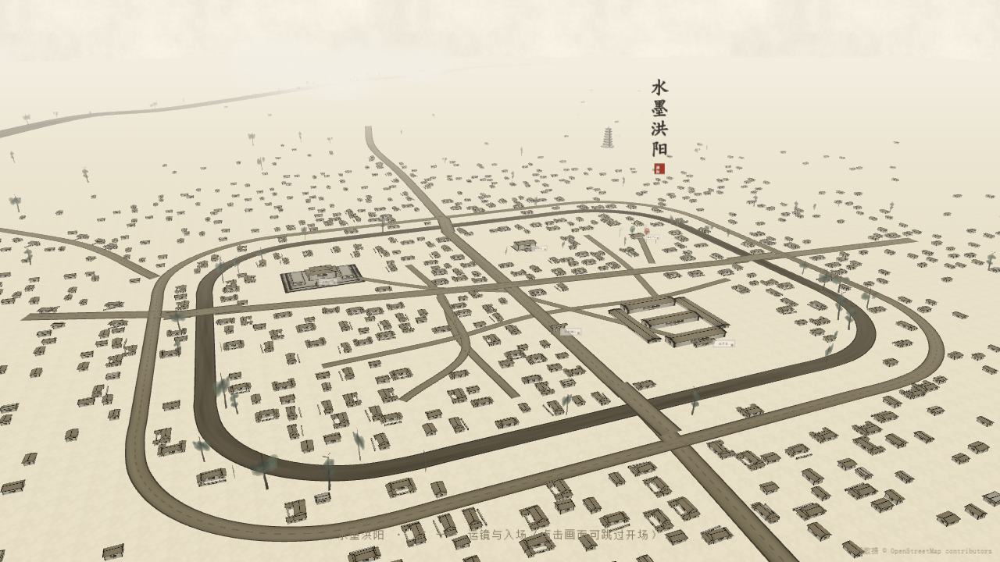
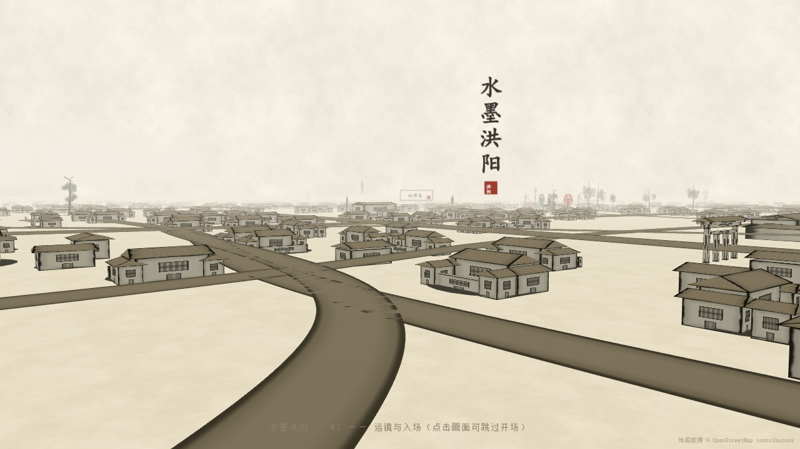

# 水墨洪阳 | Ink Hongyang

> 用 Three.js 复刻的水墨风三维古镇——广东普宁 · 洪阳镇中心

**🔗 在线体验：<https://jialiang37.github.io/shuimo-hongyang/>**

（打开页面后有一段 17 秒的开场运镜：从培风塔起飞、掠过榕江南河、沿城内河推入老城；点击画面任意处可跳过。）

## 预览

全城俯瞰（宣纸底 · 水墨雾 · 千栋潮汕民居）：



拉近看民居：白墙纸筋质感、格扇窗、屋顶瓦线、接地阴影：



## 这是什么

一座用代码"画"出来的水墨古镇。以广东普宁洪阳镇中心为原型，基于真实 OpenStreetMap 水系与路网数据，程序化生成千栋潮汕民居（下山虎 / 四点金 / 小屋），配合自定义水墨着色器，在浏览器里呈现一幅"可以走进去的水墨长卷"。

### 已实现

- **水墨渲染**：宣纸底纹、自适应雾（墨分五色）、fBm 晕染浮现转场、湿墨边缘
- **实测数据**：榕江南河、城内河、护城河环、老街巷——水系与路网走向取自 OSM 实测
- **程序化民居**：1043 栋下山虎 / 四点金式体块，沿街成排、中心密周边疏
- **地标六件套**：德安里、普宁学宫（重檐庑殿）、城隍庙、培风塔（八角七层）、老街牌坊、英歌广场
- **氛围动效**：程序化古筝 BGM（五声音阶拨弦合成）、鸟鸣风声环境音、8 名英歌舞者绕台表演、飞鸟绕塔、漂移云雾
- **昼夜切换**：右上角"日/暮"一键入夜，全城暖染、窗户透出灯光
- **性能**：全场景合并后仅 40 余次 draw call，桌面 144 FPS，移动端自动降级

## 本地运行

```bash
npm install
npm run dev      # 开发预览 http://localhost:5173
npm run build    # 构建产物到 dist/
```

## 技术栈

- [Three.js](https://threejs.org/) r180 —— 渲染
- [Vite](https://vitejs.dev/) —— 构建与开发服务
- 自定义 ShaderMaterial —— 水面 / 道路 / 建筑水墨着色
- 程序化生成 —— 宣纸纹理、水墨树、建筑体块全部由代码合成，无外部模型

## 数据来源与致谢

- 地图数据 © [OpenStreetMap](https://www.openstreetmap.org/copyright) contributors（ODbL）
- 洪阳镇人文背景参考公开史料整理

## 许可证

代码以 [MIT](LICENSE) 许可开源。

---

*水墨洪阳 · 广东普宁 · 洪阳镇*
